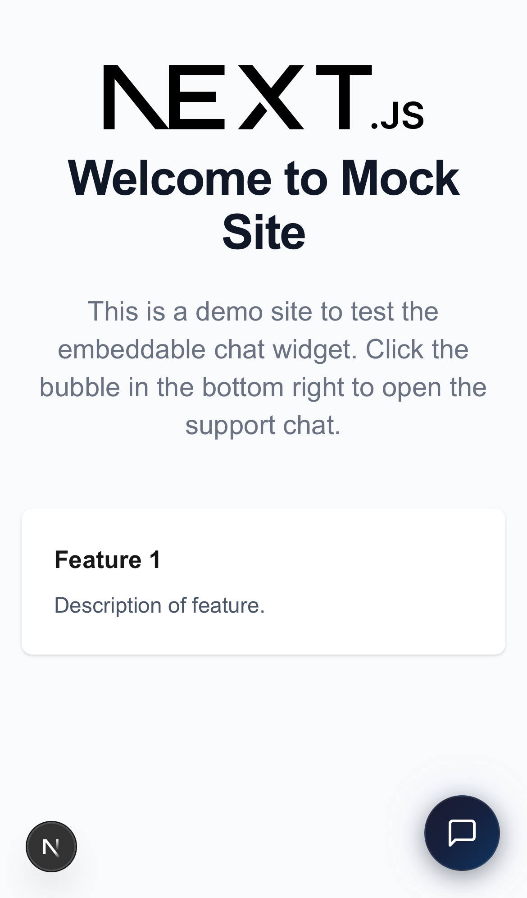
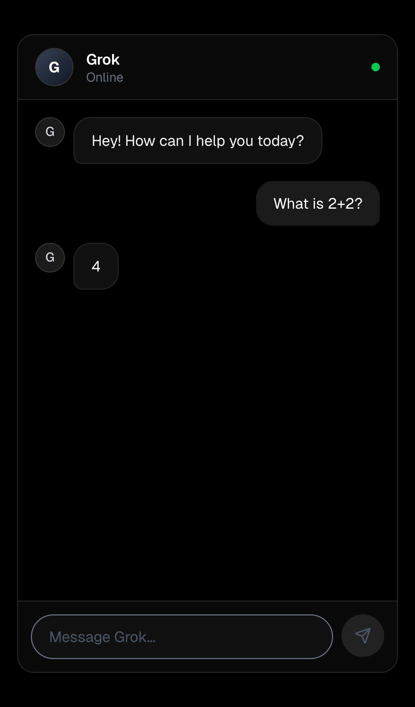

# Grok support widget

**One script tag adds a Grok-powered support chat to any website. I built it for an xAI interview in December 2025: 13 commits in about eight hours on Dec 8.**

The visitor sees a chat bubble. Behind it are four pieces:

- a server-side proxy that keeps the API key off the client
- a router that starts each conversation on a fast Grok model and moves it to a reasoning model when the conversation gets harder
- a ticket tool the model can call
- an admin dashboard where Grok grades its own conversations

Built by [Jacob Lopez](https://jacob.com.ai).

<table>
  <tr>
    <td width="50%"></td>
    <td width="50%"></td>
  </tr>
  <tr>
    <td align="center"><sub>The customer site, with the widget injected by one script tag</sub></td>
    <td align="center"><sub>The chat, streaming a live Grok reply</sub></td>
  </tr>
</table>

<sub>Both screenshots were taken by the Playwright E2E suite against the running apps.</sub>

## What it does

- **One-line embed.** `<script src="https://your-chat-host/widget.js" data-customer-id="acme" async></script>` adds the bubble and loads the chat in an iframe, so its styles and scripts can't collide with the host page. See [`public/widget.js`](apps/chatbot/public/widget.js) and the [mock customer site](apps/mock-site/app/page.tsx).
- **A proxy that keeps the key server-side.** The browser never sees `XAI_API_KEY`. [`/api/chat`](apps/chatbot/app/api/chat/route.ts) checks the request's origin against an allowlist and validates the input: messages must be present, the last turn must come from the user, and that turn is capped at 4,000 characters. It then streams the reply with Vercel AI SDK v5's `streamText`.
- **Escalation mid-conversation.** Every session starts on `grok-4-1-fast-non-reasoning`. If the history gets long or includes code, math, or reasoning language, the session moves to `grok-4-1-fast-reasoning` and stays there. Every switch is logged with the signals that caused it.
- **Tool calling.** When a user reports a problem, the model can call `createTicket`. The ticket shows up in the chat as a [card](apps/chatbot/components/TicketCard.tsx).
- **Traces and self-grading.** Every conversation writes a structured trace: model, routing decision, token usage, duration, tool steps, and errors. In `/admin`, Grok grades a trace against default or custom criteria. A reasoning model then combines the grades into a list of suggested improvements. See [`app/api/admin`](apps/chatbot/app/api/admin) and the [dashboard](apps/chatbot/app/admin/page.tsx).
- **Tests.** Jest covers the widget and the auth code. [Playwright](apps/chatbot/e2e/widget.spec.ts) covers streaming, origin blocking, input limits, admin auth, and the embed, on Chromium, Firefox, WebKit, and two mobile viewports.

## Hardened before publishing

The interview build used a static admin cookie and a default password, which was fine on a laptop but not in public. Before making the repo public in October 2026, I fixed three things:

- Admin sessions are now HMAC-signed and expire after an hour. There's no default password: `/admin` stays locked until `ADMIN_PASSWORD` is set. See [`lib/admin-session.ts`](apps/chatbot/lib/admin-session.ts).
- Session IDs become trace filenames, so they're validated before they touch the filesystem. That blocks `../` traversal through a crafted cookie. See [`lib/session-id.ts`](apps/chatbot/lib/session-id.ts).
- The public trace listing is gone. Traces are admin-only.

The rest is the original commit history from Dec 8, 2025. I also removed my agent session transcript and planning notes.

## Run it

```bash
pnpm install
cp .env.example apps/chatbot/.env.local   # add your xAI key and an admin password
pnpm dev
```

| URL | What |
|---|---|
| http://localhost:3000 | The mock customer site, with the widget embedded |
| http://localhost:3001/chat | The chat on its own |
| http://localhost:3001/admin | Traces, grading, and metrics |

| Variable | Purpose |
|---|---|
| `XAI_API_KEY` | Server-side key from [console.x.ai](https://console.x.ai) |
| `ALLOWED_ORIGINS` | Hosts allowed to call `/api/chat` from a browser, such as `localhost:3000` |
| `ADMIN_PASSWORD` | Turns on `/admin`. There's no default. |
| `ADMIN_SESSION_SECRET` | Optional key for signing admin cookies. Defaults to `ADMIN_PASSWORD`. |

```bash
pnpm --filter chatbot test       # unit tests
pnpm --filter chatbot test:e2e   # end-to-end; needs XAI_API_KEY and both apps running
```

## Stack

Next.js 16 (App Router, Turbopack) · TypeScript · Vercel AI SDK v5 with `@ai-sdk/xai` · shadcn/ui, Tailwind, Radix · Recharts · Jest · Playwright · Turborepo with pnpm workspaces

## Known limits

- Traces and tickets are JSON files on local disk. That's fine for a demo, but a deployment on more than one instance needs a database or object storage.
- There's no rate limiting. The origin check stops other websites from using the widget, but it doesn't stop scripts that call the API directly.

## More

Two months later I shipped always-on agents you can text: [TXT CLAW → Rotary](https://github.com/woodbeary/rotary).
